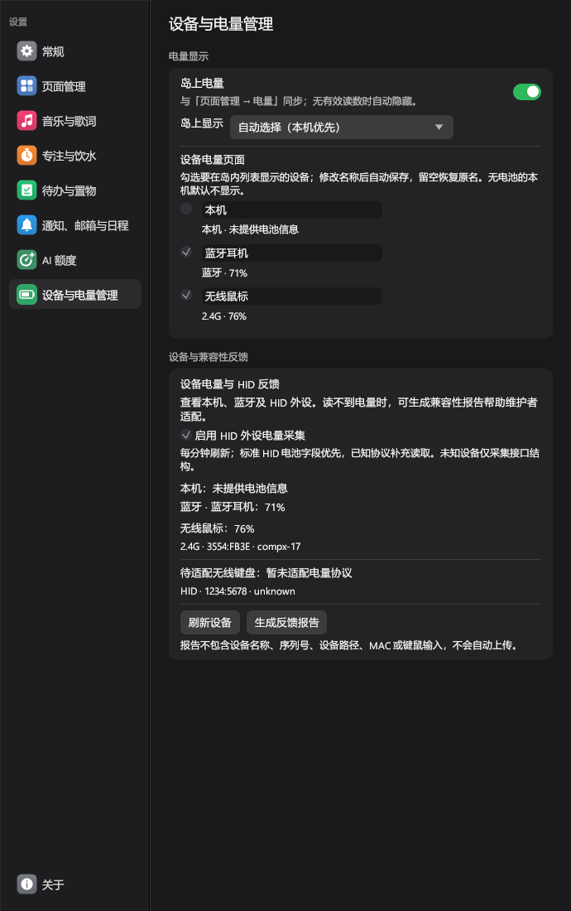
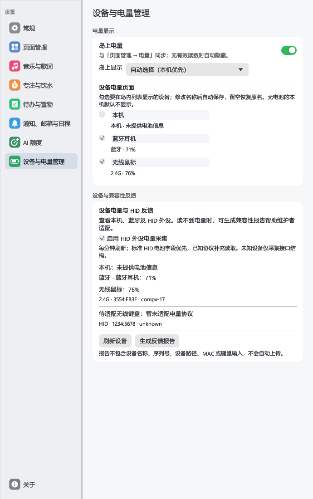
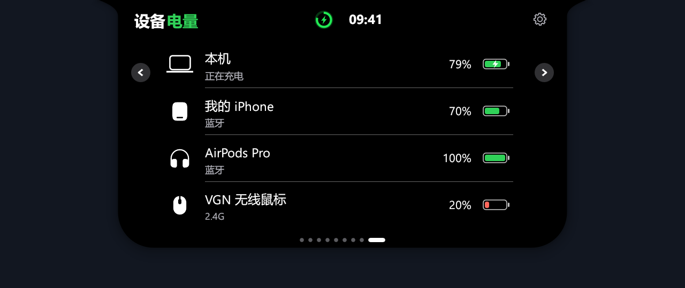

# HID 电量采集与兼容性反馈

## 设计与支持边界

本机电池继续使用 Windows 电源接口，蓝牙继续使用系统设备属性。新增独立 HID 工作线程，向界面提供设备快照，不阻塞前两条路径。HID 是通信接口，不能仅凭 USB 接口判断设备一定使用 2.4G；只有已适配的接收器才标记为 2.4G。

采集按能力而不是品牌名称分层：

1. 标准 HID：从 Windows 解析出的 Input / Feature value capabilities 寻找 Generic Device Controls / Battery Strength（06:20，按逻辑范围规范化）和 Battery System / Relative State Of Charge（85:64，字段单位已经是百分比，不再次缩放）。只获取包含电量字段的报告；不记录其余字段或原始输入。
2. HID++ 2.0：在 Logitech 厂商长报告集合中发现设备槽位与电池 feature，读取 1000 或 1004。匹配设备槽位、feature、function/software ID，避免把其他程序的回复误认成本次采样。不通过电压曲线猜测百分比。
3. MouseEnc / CompX 17 字节协议：VGN 3554:FB3E/FB3D、IMECOO 3554:FB34、ATK 373B:1278。共用严格报文解析，按设备档案选择是否先查询在线状态。新增型号需提供 VID/PID、集合特征及独立回复样例。
4. 未知协议：保留元数据与失败原因，提供反馈；不广播厂商命令、不穷举 report ID、不把固定容量字段当成电量。

常规刷新 60 秒，手动刷新有 5 秒最小间隔。每个接口 4 秒、每轮私有协议读取 12 秒的预算；拔插后重新枚举。超时、明确离线和不支持分开表示，失败时不把旧电量伪装成新读数。预算在 I/O 前后检查，私有协议输入按短片读取；Windows 同步 GetReport / SetReport 调用本身仍受驱动行为影响。HID 状态通过设备管理页更新，不把一次读取失败当成设备断开通知。

## 设置与反馈流程

设置导航中在“AI 额度”下新增“设备与电量管理”，将“设备与兼容性反馈”从“关于”迁入。此处展示本机、蓝牙和 HID 当前信息，提供 HID 开关、刷新、生成报告、预览、复制、导出和打开上游 Issue 页面。报告仅在用户请求时生成，不自动上传；提交前可审阅 JSON 并补充品牌型号、连接模式、固件版本、厂商软件显示的电量及复现过程。

`device_battery::State` 将三类来源转换为统一设备视图；顶栏布局、顶栏绘制和常驻排列预览共用 `resident_power`，移除了顶栏对 `Env.battery` 的直接依赖。本机低电量系统通知仍使用真实本机电源信息。自动选择优先本机，其次选择有有效电量的蓝牙、HID；固定选择失效则隐藏，不替用户切换设备。HID 关闭、过期或采集失败后不继续显示旧值。

歌词模式有独立绘制分支，不能只改普通顶栏。此分支为电量预留 32 点，并同步移动封面和小眼睛；电量、表情、计时同时出现时缩短歌词区域，总宽度不超过展开面板。小眼睛的电量警告仍读取 `Env.battery/charging`，避免所选鼠标 20% 被误认为本机低电量。新增回归测试先复现这两处问题，再验证蓝牙/HID、表情开关、计时开关的八种组合，检查实际透明度、裁剪和内容间距。

“岛上电量”与页面管理里的“电量”共用 `show_battery`；`battery_device` 保存顶栏设备选择，`battery_devices` 保存本地设备 ID 对应的（别名，列表可见性）。蓝牙 ID 和 HID 接口路径散列仅存本地，不进入反馈。HID 使用接口身份加接收器槽位关联偏好；换端口或驱动改变路径可能需要重新设置。不能仅凭产品名、VID/PID 合并不同设备，避免相同型号串用别名。普通未知 HID 集合仅展示诊断信息，不把每个接口都列为电池。

“设备电量”为第九个岛内页面，一次显示四行并支持内容区滚动。旧版 6/7/8 页配置保留原有顺序，新增页追加在末尾；原页面开关不变，旧配置全部隐藏时仍保留一个页面。列表显示开关独立于顶栏选择；别名留空恢复原名。蓝牙采集与通知开关解耦，关闭连接提醒不会清空电量数据。

报告使用版本化 JSON，保留应用版本、平台、VID/PID、Usage Page/Usage、报告长度、Input/Output/Feature report ID、value/button capability 数量、结构化 value capabilities、匹配的协议、状态和规范化错误。厂商字节数组可能归入 button caps，因此这部分也提取 report ID，但不采集按钮值。设备仅按报告内序号标识，省略序列号、路径、MAC、电脑名、用户名、产品自定义名称，以及按键、鼠标移动和未知报告原文。单个字段/报告数量有上限，导出不会包含整个应用数据目录。

这些信息用于识别集合、选择协议和编写解析器，不能仅凭描述符推断私有协议。需要新增适配时，由维护者基于上游协议和专门的电量抓包建立测试样例，用户无需运行任意命令扫描器。

## 维护说明（新增 / 修改 / 删除）

- 新增 `src/hid/`：通用快照、协议注册、标准字段识别、平台 I/O、后台服务、反馈 JSON 和解析测试。
- 新增 `src/hid_ui.rs`：设备管理页的诊断预览和反馈操作。
- 新增 `src/device_battery.rs`：三类来源统一视图、顶栏选择、别名、设备显示偏好和多设备列表页。
- 修改 `Cargo.toml` / `Cargo.lock`：仅 Windows 引入 hidapi，增加系统 HID 绑定。
- 修改 `src/main.rs` / `src/app.rs`：独立服务与快照传递，不将 HID 生命周期绑定到蓝牙通知开关。
- 修改 `src/model.rs` / `src/extras.rs`：设备管理导航、持久化偏好、共用开关及第九页配置迁移。
- 删除：移除关于页中的反馈模块，并迁入设备管理；移除顶栏只读取本机电池的判断；移除关闭蓝牙通知时停止采集并清空设备的逻辑。关于页恢复“版本 → 支持作者”。
- 新增或替换的关键位置使用中文 `【新增】` / `【修改】` / `【删除说明】` 注释，记录原因；旧实现以 Git diff 查看，不保留废弃代码副本。

## 验证

协议测试覆盖真实样例、错误状态、截断、校验和、串包、0% / 100%、逻辑范围和不支持路径；服务测试覆盖限频、取消和失败状态；反馈测试验证 JSON schema 与隐私字段；界面测试使用合成设备。另需 Windows MSVC 全量测试和运行库检查，实机确认不同接收器、休眠唤醒、拔插、多设备与厂商软件并行运行。

本分支使用 Windows GNU 工具链运行全目标测试（`--all-targets --features record -- --test-threads=1`），并单独导出设备管理与电量列表截图。测试覆盖旧配置迁移、无本机电池时显示外设电量、固定选择断开、HID 关闭/过期/离线、偏好保存与重连、列表滚动、开关同步及设置真实点击。测试机没有 Windows SDK，验证时仅在临时目录提供 GNU 工具和编译后的现有图标对象，未修改仓库发布脚本；MSVC 发布构建和运行库检查仍由现有 Windows CI 执行。

最新全目标回归：532 项通过，53 项按需测试跳过；另行执行歌词与电量共存截图用例通过（普通歌词、歌词加计时两种场景），主程序构建成功。测试使用独立 `TMP` 目录，避开本机默认临时目录在并发保存测试清理阶段偶发返回“目录不是空的”的问题；没有为此修改生产保存逻辑或跳过该测试。

| 采集路径 | 当前证据与边界 |
| --- | --- |
| 标准 HID | 描述符识别、百分比换算、越界和过期读数有测试；依赖设备确实声明并提供对应电池字段 |
| HID++ 2.0 | feature 发现、百分比能力检查、槽位/软件号匹配有假设备测试；本次没有对应硬件实测，不宣称所有 Logitech 设备支持 |
| VGN 3554:FB3E | 有参考项目在线 20% 采样测试；本次原生采集识别接口并正确解析接收器离线回复，没有用历史值替代 |
| VGN 有线 / ATK / IMECOO | 精确接口匹配及参考报文解析有测试；本次未进行这些型号的独立硬件验证 |
| 未适配设备 | 只生成结构化元数据，不尝试猜测电量或执行私有命令 |

设备管理页深浅色截图和岛内列表均使用合成设备，可以随 PR 提交，不含真实硬件标识：

歌词模式与外设电量共存，小眼睛不因外设 20% 而警告：

## 协议资料

- [USB HID Usage Tables](https://usb.org/hid)
- [Microsoft：HID 报文解释](https://learn.microsoft.com/en-us/windows-hardware/drivers/hid/interpreting-hid-reports)
- [Logitech HID++ 2.0](https://github.com/Logitech/cpg-docs/tree/master/hidpp20)
- [Voltide ATK / IMECOO 适配器（MIT）](https://github.com/sdparklab/Voltide/tree/6f36629b415942ad49305190604382644f7240dc/src/Providers)
- [BatteryMonitor VGN 适配器（MIT）](https://github.com/JKWTCN/BatteryMonitor/blob/main/src/providers/hid/VgnHidProvider.cpp)

引用/移植的 MIT 版权声明保存在 `THIRD_PARTY_NOTICES.txt`；新增协议请同时补充来源、精确匹配条件和测试样例，不以品牌名模糊匹配。
